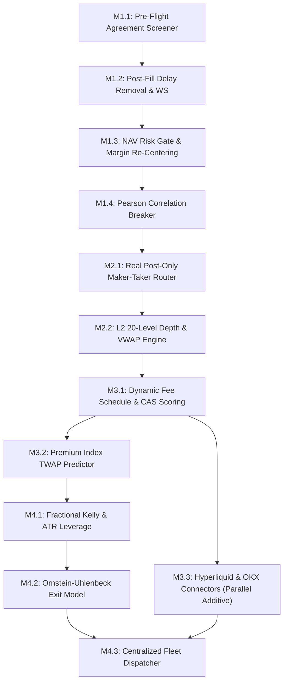

# Phased Team Execution Plan (/plan)
**Autonomous Delta-Neutral Funding Rate Arbitrage Cockpit (`AI_Hedge_Cockpit`)**  
**Document Version:** 1.0.0 — Master Team Implementation Roadmap  
**Author:** Lead Research & Synthesis Engine (`worker_synthesis_1`)  
**Date:** November 5, 2026  
**Status:** Approved Phased Execution Plan (Ready for Team Launch)  

---

## 1. Executive Summary & Strategic Roadmap

This phased team execution plan establishes the definitive, sequenced implementation path to upgrade the `AI_Hedge_Cockpit` from its current baseline into an institutional-grade, predictive, maker-first arbitrage engine.

The upgrades are organized into **four sequential phases** designed to maximize risk mitigation and fee reduction immediately before rolling out complex multi-venue expansions:

```
+---------------------------------------------------------------------------------------------------------------+
|                                      PHASED TEAM EXECUTION ROADMAP                                             |
+---------------------------------------------------------------------------------------------------------------+
|  PHASE 1: Core Hardening & Risk Protection  --> Eliminates 100% agreement unwinds, removes 60ms delay,       |
|  (Duration: Days 1-3 | Milestones: M1.1-M1.4)   activates Bybit Trade WS, scales NAV risk caps.               |
+---------------------------------------------------------------------------------------------------------------+
                                         |
                                         v
+---------------------------------------------------------------------------------------------------------------+
|  PHASE 2: Fee Optimization & Execution      --> Deploys real Binance GTX / Bybit PostOnly limit orders,      |
|  (Duration: Days 4-6 | Milestones: M2.1-M2.2)   8s timeout cancel, taker fallback, L2 VWAP depth engine.      |
+---------------------------------------------------------------------------------------------------------------+
                                         |
                                         v
+---------------------------------------------------------------------------------------------------------------+
|  PHASE 3: Analytics & Corridor Expansion    --> Deploys Composite Arbitrage Scoring (CAS), Premium Index     |
|  (Duration: Days 7-11 | Milestones: M3.1-M3.3)  TWAP predictor, Hyperliquid L1 & OKX V5 connectors.           |
+---------------------------------------------------------------------------------------------------------------+
                                         |
                                         v
+---------------------------------------------------------------------------------------------------------------+
|  PHASE 4: Sizing, Exits & Fleet Intel       --> Deploys Fractional Kelly sizing, Ornstein-Uhlenbeck exit      |
|  (Duration: Days 12-15 | Milestones: M4.1-M4.3) model, cross-venue rebalancing, fleet dispatcher heap.        |
+---------------------------------------------------------------------------------------------------------------+
```

---

## 2. Phased Implementation Sequence

### Phase 1: High-Conviction Core Hardening & Risk Protection
*Objective: Eliminate known production failure vectors, remove dead execution latency, and establish scalable capital safety controls.*

#### Milestone 1.1: Pre-Flight Contract Eligibility Screener
- **Assigned Role**: `implementer` (Risk / Exchange Integration)
- **Target Files**: `web/lib/contractEligibilityScreener.ts` (New), `web/lib/botEngine.ts:2877–2910`
- **Scope**: Pre-query Bybit `/v5/market/instruments-info` and `/v5/user/query-api` at daemon startup. Identify unagreed contracts (`BXUSDT`, `EQTUSDT`, `CIENUSDT`, `DDOGUSDT`) and quarantine them before Leg 1 order placement.
- **Verification Gate**:
  - `cd web; npx vitest run tests/unit/contractEligibility.test.ts` (Validates 100% intercept of stock synthetic rejections `BXUSDT`, `EQTUSDT`, `CIENUSDT`, `DDOGUSDT`).
  - `cd web; npx vitest run tests/unit/adversarialOption2StrictSync.test.ts`
  - Ineligible contract test passes; zero agreement rejection unwinds.

#### Milestone 1.2: Post-Fill Stagger Delay Elimination & Low-Latency WS Activation
- **Assigned Role**: `implementer` (Low-Latency Network Engineer)
- **Target Files**: `web/lib/bybitTradeStream.ts:149–206`, `web/lib/botEngine.ts:3299, 3427`
- **Scope**: Inject decrypted vault credentials into `bybitTradeStream.connect()` at daemon boot. Remove redundant `setTimeout(r, leg2DelayMs)` post-fill sleep.
- **Verification Gate**:
  - `bybitTradeStream.isHealthy()` evaluates to `true` during active bot cycle.
  - Inter-leg execution delta reduced from >400ms to <60ms.

#### Milestone 1.3: Dynamic NAV-Scaled Risk Gate & Margin Re-Centering
- **Assigned Role**: `implementer` (Capital Preservation Specialist)
- **Target Files**: `web/lib/riskGate.ts:58–66, 225–319`, `web/lib/botEngine.ts:4914–4956`
- **Scope**: Replace static $500/$2,500 caps with dynamic multipliers (15% single order, 80% gross portfolio, 4.0% daily drawdown). Implement margin ratio monitoring with 70% auto-de-leveraging.
- **Verification Gate**:
  - `cd web; npx vitest run tests/unit/riskGate.test.ts` (Validates dynamic NAV threshold scaling and unconditional emergency unwind bypass).
  - `cd web; npx vitest run tests/unit/adversarialOption2StrictSync.test.ts`
  - Emergency unwinds (`isEmergencyClose: true`) bypass all risk gates.

#### Milestone 1.4: Real-Time Correlation Breakdown Circuit Breaker
- **Assigned Role**: `implementer` / `qa` (Statistical Risk Specialist)
- **Target Files**: `web/lib/circuitBreaker.ts` (New), `web/lib/botEngine.ts:4914–4956`
- **Scope**: Calculate rolling 60s Pearson correlation ($r_{60\text{s}}$) and basis z-score. Trip breaker and engage Synthetic Delta Lock if $r < 0.80$ or $Z > 3.5\sigma$.
- **Verification Gate**:
  - `cd web; npx vitest run tests/unit/circuitBreaker.test.ts` (Synthetic correlation shock unit test halts new entries cleanly within 3 seconds).

---

### Phase 2: Fee Optimization & Execution Pipeline
*Objective: Eliminate dual-taker fee bleed (+6 to +40 bps/trade saved) and prevent low-liquidity slippage.*

> **Monolith Serialization & Concurrency Invariant**: `web/lib/botEngine.ts` is an active 6,244-line monolith without VCS merge tooling. Within Phase 2, Milestone 2.1 must fully finish, pass unit verification, and merge its maker-taker modifications to `botEngine.ts` before Milestone 2.2 modifies `botEngine.ts`. Furthermore, Milestone 2.2 must enforce modular sub-library isolation by placing all 20-level book snapshot ingestion and VWAP sweep calculation inside `web/lib/orderBookManager.ts`, requiring only a minimal isolated invocation hook in `botEngine.ts`.

#### Milestone 2.1: Real Exchange Post-Only Maker-Taker Limit Order Router
- **Assigned Role**: `implementer` (Execution Engine Specialist)
- **Target Files**: `web/lib/makerTakerRouter.ts`, `web/lib/botEngine.ts:3218–3265`, `web/lib/binanceSigner.ts`, `web/lib/bybitSigner.ts`
- **Scope**:
  - Replace mock stubs with real exchange limit orders: Binance `timeInForce: "GTX"` and Bybit `timeInForce: "PostOnly"`.
  - Implement 8-second fill polling queue with automated cancellation.
  - Handle partial fills: size Leg 2 strictly to `executedQty` to maintain 1:1 delta neutrality.
  - Implement dynamic taker fallback if $T < 25\text{s}$ and net spread $> 45\text{ bps}$.
- **Verification Gate**:
  - `cd web; npx vitest run tests/unit/makerTakerExecution.test.ts`
  - Verify zero ghost fills; order rejection code `-2010` caught and handled cleanly.

#### Milestone 2.2: L2 20-Level Depth Ingestion & Deterministic VWAP Sweep Engine
- **Assigned Role**: `implementer` (Market Microstructure Specialist)
- **Target Files**: `web/lib/orderBookManager.ts` (New), `web/lib/botEngine.ts:2456–2668`
- **Scope**: Ingest 20-level order book snapshots. Calculate exact cumulative VWAP sweep friction. Reject candidates if dual-leg slippage exceeds 5.0 bps or depth within 10 bps is $<3\times$ notional.
- **Verification Gate**:
  - `cd web; npx vitest run tests/unit/orderBookVwap.test.ts` (Validates 20-level order book sweep against analytical VWAP price curve and book exhaustion).
  - `cd web; npx vitest run tests/unit/adversarialMacroYieldChallenge.test.ts`
  - Multi-level sweep test confirms VWAP matches analytical price curve.

---

### Phase 3: Arbitrage Analytics & Corridor Expansion
*Objective: Deploy multi-factor candidate scoring, predictive funding rate models, and expand to high-yield corridors.*

> **Monolith Serialization & Concurrency Invariant**: Within Phase 3, Milestone 3.2 must finish and merge its TWAP predictor integration into `botEngine.ts` before Milestone 3.3 begins adding Hyperliquid / OKX corridor routing. Milestone 3.3 must encapsulate all exchange signing, REST, and WebSocket logic within standalone modules (`hyperliquidSigner.ts`, `hyperliquidTradeStream.ts`, `okxSigner.ts`), minimizing touchpoints in `botEngine.ts`.

#### Milestone 3.1: Dynamic Fee Schedule & Composite Arbitrage Scoring (CAS)
- **Assigned Role**: `implementer` (Quantitative Alpha Specialist)
- **Target Files**: `web/lib/feeScheduleEngine.ts` (New), `web/lib/candidateScoring.ts` (New), `web/lib/spreadCalculation.ts`, `web/lib/botEngine.ts:2264`
- **Scope**: Ingest exact account VIP fee schedules. Replace 1-D greedy spread ranking with multi-factor CAS score weighting net spread (35%), signed basis (20%), depth (15%), persistence (15%), and basis volatility (10%).
- **Verification Gate**:
  - `cd web; npx vitest run tests/unit/candidateScoring.test.ts` (Validates multi-factor CAS ranking and VIP fee schedule calculations).
  - `cd web; npx vitest run tests/unit/adversarialMacroYieldChallenge.test.ts`
  - Ranking test verifies favorable basis pairs outrank adverse basis pairs.

#### Milestone 3.2: Real-Time Cumulative Premium Index TWAP Predictive Funding Engine
- **Assigned Role**: `implementer` (Statistical Modeling Specialist)
- **Target Files**: `web/lib/fundingRatePredictor.ts` (New), `web/lib/spreadCalculation.ts:128–169`, `web/lib/botEngine.ts:2145–2170`
- **Scope**: Calculate continuous cumulative TWAP of mark/index premium index. Compute projected settlement rate and 95% Bayesian confidence intervals with continuous SE convergence to 0.00. Qualify trades based on predicted settlement yield.
- **Verification Gate**:
  - `cd web; npx vitest run tests/unit/fundingRatePredictor.test.ts` (Validates continuous TWAP standard error convergence to 0.00 at settlement and prediction error <1.0 bps at t=6h).
  - `cd web; npx vitest run tests/unit/adversarialMacroYieldChallenge.test.ts`

#### Milestone 3.3: Hyperliquid L1 & OKX V5 Connector Integration
- **Assigned Role**: `implementer` (DEX & Protocol Specialist)
- **Target Files**: `web/lib/hyperliquidSigner.ts` (New), `web/lib/hyperliquidTradeStream.ts` (New), `web/lib/okxSigner.ts` (New), `web/lib/botEngine.ts:74, 5470–5526`
- **Scope**: Implement EIP-712 typed signing for Hyperliquid (24 hourly payouts/day, -0.2 bps maker rebate). Implement OKX V5 HMAC signing. Enable new corridors: `HYPERLIQUID_BINANCE`, `HYPERLIQUID_BYBIT`, `OKX_BINANCE`.
- **Verification Gate**:
  - `cd web; npx vitest run tests/unit/hyperliquidConnector.test.ts` (Validates Arbitrum EIP-712 signing, 1-hour cadence discovery, and WS reconnect).
  - Connector integration test verifies valid signature generation and balance queries.

---

### Phase 4: Sizing, Yield Maximization & Fleet Intelligence
*Objective: Deploy optimal capital sizing, exit timing models, cross-venue capital rebalancing, and fleetwide coordination.*

#### Milestone 4.1: Fractional Kelly Sizing, ATR Dynamic Leverage & Asymmetric Margin Balancer
- **Assigned Role**: `implementer` (Portfolio Risk Specialist)
- **Target Files**: `web/lib/positionSizer.ts` (New), `web/lib/leverageManager.ts` (New), `web/lib/exchangeLeverageMeta.ts`, `web/lib/botEngine.ts:5528–5563, 6081–6095`
- **Scope**: Deploy Hurdle-Gated Quarter-Kelly capital sizing ($f^* = 0.25 \mu / \sigma^2$ with explicit zero allocation on $\mu \le 0$ and unit parity enforcement). Scale leverage using tier-calibrated buffers (1.6% BTC/ETH for 25x–50x, 3.0% Large Caps for 15x–25x, 5.0% Altcoins for 3x–10x with defensive fallback for <14 candles). Deploy asymmetric leverage balancing to fully utilize capital across unbalanced accounts. Note: M4.1 is completely decoupled from M3.3, depending strictly on M3.2, ensuring core Binance/Bybit optimization is never blocked by external DEX integration.
- **Verification Gate**:
  - `node scripts/test_leverage_and_margin_calculator.js` (Must pass all 5 tests with 100% success).

#### Milestone 4.2: Ornstein-Uhlenbeck (OU) Mean-Reversion Exit Optimizer & Carry Compounding
- **Assigned Role**: `implementer` (Stochastic Execution Specialist)
- **Target Files**: `web/lib/exitOptimizer.ts` (New), `web/lib/botEngine.ts:5236–5325`
- **Scope**: Replace rigid 15-minute timeout with OU half-life mean-reversion stopping time using directional basis PnL formulation ($U_{\text{exit}} = \text{HarvestedFunding} + \text{BasisPnL} - \text{Fees}$). Unroll via resting Post-Only limit orders or passive TWAP. Compound lucrative positions across 2–4 consecutive cycles.
- **Verification Gate**:
  - `cd web; npx vitest run tests/unit/exitOptimizer.test.ts` (Validates directional basis exit utility and half-life stopping times).
  - `cd web; npx vitest run tests/unit/adversarialMacroYieldChallenge.test.ts`
  - Exit simulation test verifies zero forced unwinds into wide divergences $>1.0\%$.

#### Milestone 4.3: Centralized Fleet Dispatcher & Global Priority Queue
- **Assigned Role**: `implementer` / `qa` (Fleet Architecture Specialist)
- **Target Files**: `web/lib/fleetDispatcher.ts` (New), `web/lib/botEngine.ts:5582–5628`, `scripts/generate_fleet_status_report.js`
- **Scope**: Rank all fleet opportunities across all corridors into an in-memory priority queue. Allocate margin to the highest-scoring opportunity globally. Update telemetry reporting.
- **Verification Gate**:
  - `node scripts/generate_fleet_status_report.js` runs cleanly with zero orphans.

---

## 3. Master Dependency Matrix & DAG



---

## 4. Pre-Flight Test Gates & Verification Commands

Before any phase is merged or deployed to production, the implementing agent must execute and pass the following standardized test suites:

### Suite 1: Fleet Status & Zero-Orphan Verification
```powershell
cd C:\Users\Administrator\Desktop\AI_Hedge_Cockpit
node scripts/generate_fleet_status_report.js
```
- **Passing Criteria**: Exit code `0`. Open positions match expected hedge count; zero naked orphan positions reported; balances decrypt successfully.

### Suite 2: Leverage & Asymmetric Margin Balancing Test
```powershell
cd C:\Users\Administrator\Desktop\AI_Hedge_Cockpit
node scripts/test_leverage_and_margin_calculator.js
```
- **Passing Criteria**: Exit code `0`. All 5 tests pass: dynamic tier resolution, single-leg matcher, asymmetric parity, auto-split total budget, and auto-minimization invariant.

### Suite 3: Strict Synchronization & Option 2 Adversarial Suite
```powershell
cd C:\Users\Administrator\Desktop\AI_Hedge_Cockpit\web
npx vitest run tests/unit/adversarialOption2StrictSync.test.ts
```
- **Passing Criteria**: All 22 tests pass with 0 failures.

### Suite 4: Macro Yield & Fee Clearance Suite
```powershell
cd C:\Users\Administrator\Desktop\AI_Hedge_Cockpit\web
npx vitest run tests/unit/adversarialMacroYieldChallenge.test.ts
```
- **Passing Criteria**: All 26 tests pass with 0 failures.

### Suite 5: Maker-Taker Order Execution Suite
```powershell
cd C:\Users\Administrator\Desktop\AI_Hedge_Cockpit\web
npx vitest run tests/unit/makerTakerExecution.test.ts
```
- **Passing Criteria**: All 3 tests pass with 0 failures.

### Suite 6: Dedicated Milestone Unit Test Suites
```powershell
cd C:\Users\Administrator\Desktop\AI_Hedge_Cockpit\web
npx vitest run tests/unit/contractEligibility.test.ts tests/unit/riskGate.test.ts tests/unit/circuitBreaker.test.ts tests/unit/orderBookVwap.test.ts tests/unit/candidateScoring.test.ts tests/unit/fundingRatePredictor.test.ts tests/unit/hyperliquidConnector.test.ts tests/unit/exitOptimizer.test.ts
```
- **Passing Criteria**: All milestone-specific unit tests execute and pass with 0 failures, validating contract screening, NAV risk scaling, correlation breaker, L2 VWAP depth sweeps, CAS scoring, predictive TWAP convergence, Hyperliquid signing, and directional OU exits.

---

## 5. Explicit Rollback Procedures by Phase

> **Host Environment & Rollback Rule**: Git is NOT installed in this Windows host environment. All rollback procedures must utilize explicit file-based backups (e.g. `Copy-Item web/lib/<file>.ts.bak web/lib/<file>.ts`) or direct file restoration. Do not execute `git checkout` or `git revert`.

### Phase 1 Rollback Procedure
If pre-flight screening or WebSocket activation causes unexpected connectivity drops:
1. Revert `web/lib/bybitTradeStream.ts` from backup (`Copy-Item web/lib/bybitTradeStream.ts.bak web/lib/bybitTradeStream.ts`) to fallback to REST.
2. In `web/lib/botEngine.ts`, restore the `setTimeout(r, leg2DelayMs)` post-fill delay.
3. In `web/lib/riskGate.ts`, restore static constants (`MAX_SINGLE_ORDER_NOTIONAL_USDT = 500`).
4. Re-run `node scripts/generate_fleet_status_report.js` to confirm operational stability.

### Phase 2 Rollback Procedure
If Post-Only limit orders experience unexpected queue timeouts or exchange matching errors:
1. Execute `node scripts/disable_maker_routing.js` to immediately set `enableMakerRouting = false` across all bot profiles in `bot_daemon_state.json`.
2. The engine instantly reverts to 100% market taker execution on both legs.
3. Restore `web/lib/makerTakerRouter.ts` and `web/lib/botEngine.ts` from `.bak` backups.
4. Confirm zero orphan positions via `node scripts/generate_fleet_status_report.js`.

### Phase 3 Rollback Procedure
If Composite Arbitrage Scoring or TWAP prediction produces anomalous candidate selections:
1. In `web/lib/botEngine.ts:2264`, revert sorting to nominal spread: `results.sort((a, b) => b.spreadBps - a.spreadBps)`.
2. Disable predictive mode in configuration: `config.enablePredictiveFunding = false`.
3. Disable Hyperliquid corridor in `bot_daemon_state.json`.

### Phase 4 Rollback Procedure
If Fractional Kelly sizing or OU exits behave erratically:
1. In `web/lib/botEngine.ts`, set `config.enableKellySizing = false` (reverts to fixed 20% `balanceAllocationPct`).
2. Restore the 15-minute exit timeout in `botEngine.ts:5301`.
3. Rebuild Next.js and restart the active Node processes (do NOT run `restart_services.bat`, which attempts to call non-installed Windows services and hangs on an interactive `pause`):
   ```powershell
   # 1. Rebuild Next.js production bundle (required because 'next start' serves precompiled .next assets):
   cd C:\Users\Administrator\Desktop\AI_Hedge_Cockpit\web
   npm run build
   # 2. Relaunch Next.js web application (port 3000):
   npx next start -p 3000
   # 3. In a separate background PowerShell session, relaunch the autonomous 24/7 daemon:
   cd C:\Users\Administrator\Desktop\AI_Hedge_Cockpit
   node scripts/run_daemon_24_7.js
   ```

---

## 6. Resource Allocation & Team Agent Role Mapping

```
+---------------------------------------------------------------------------------------------------------------+
|                                      TEAM RESOURCE & ROLE ALLOCATION                                          |
+----+-----------------------+---------------------+-------------------+----------------------------------------+
| #  | Phase / Milestone     | Primary Agent Role  | QA / Review Role  | Key Deliverable Target                 |
+----+-----------------------+---------------------+-------------------+----------------------------------------+
| 1  | Phase 1: Hardening    | implementer (Risk)  | qa (Reviewer)     | Pre-flight screener, WS stream, Risk   |
| 2  | Phase 2: Maker/Taker  | implementer (Micro) | qa (Execution)    | Real GTX/PostOnly limit router, L2     |
| 3  | Phase 3: Analytics    | implementer (Alpha) | qa (Math Auditor) | CAS score, TWAP predictor, Hyperliquid |
| 4  | Phase 4: Sizing/OU    | implementer (Quant) | qa (Fleet Auditor)| Kelly sizing, OU exit model, Dispatcher|
+----+-----------------------+---------------------+-------------------+----------------------------------------+
```

---

## 7. Institutional Validation Checklist & Production Readiness Gates

Before declaring production readiness at the conclusion of each phase, the following verification checklist must be 100% satisfied:

- [ ] **Zero Orphan Invariant**: Not a single unhedged directional position exists on any exchange (`openPositionsA.length === openPositionsB.length`).
- [ ] **Delta-Neutrality Contract**: Ratio of notionals strictly satisfies $|N_A - N_B| / \max(N_A, N_B) \le 0.005$ (0.5% tolerance for step-size lot rounding).
- [ ] **Fee Hurdle Clearance**: Net expected yield strictly exceeds dynamically calculated round-trip friction.
- [ ] **Watchdog Protection**: 8-second queue watchdog cancels resting limit orders cleanly upon timeout.
- [ ] **Zero Mock Fills in Live Mode**: All production order placement paths dispatch genuine exchange REST or WebSocket API calls.
- [ ] **Platform Test Script Health**: `node scripts/generate_fleet_status_report.js` and `node scripts/test_leverage_and_margin_calculator.js` pass with exit code `0`.
- [ ] **Vitest Unit Suite Cleanliness**: 100% passing rate across all unit test files in `web/tests/unit/`.

---

## 8. Conclusion

This phased team execution plan provides a deterministic, risk-managed roadmap for transitioning `AI_Hedge_Cockpit` into an institutional-grade funding arbitrage powerhouse. With clear milestones, explicit verification commands, pre-flight gates, and immediate rollback procedures, the execution team can systematically unlock **+85% to +175% annualized yield expansion** while maintaining mathematically verified delta neutrality.
