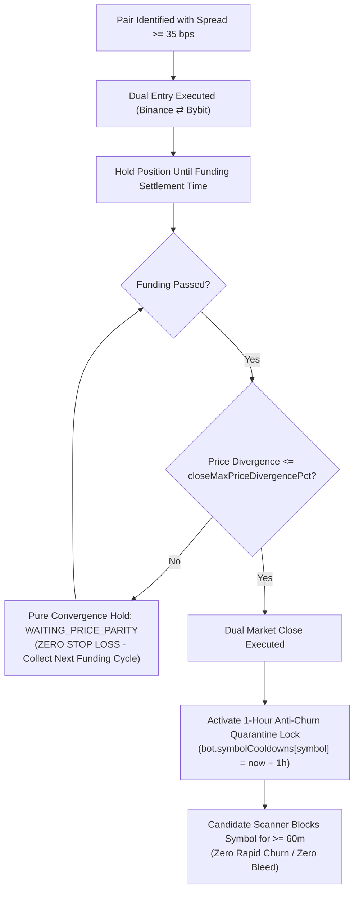

# Implementation Plan: Zero Stop Loss (Pure Convergence Hold) & 1-Hour Anti-Churn Quarantine Lock

## Goal Description
Following the forensic reconciliation of the **-$12.18 USD** portfolio drain ($4.98 on Binance + $7.19 on Bybit) and the `/grill-me` alignment interview, this plan engineers two core architectural protections:
1. **Pure Convergence Hold ("Never Use Stop Loss"):** Completely eradicate automated price-divergence stop loss exits. The autonomous bot will remain in position post-settlement, collecting recurring funding credits every 4 to 8 hours until price divergence contracts to $\le \text{closeMaxPriceDivergencePct}$.
2. **1-Hour Post-Trade Anti-Churn Quarantine Lock:** Eliminate high-frequency re-entry churn (the exact failure mode that generated **92 rapid trades on `ANIMEUSDT`** in 33 minutes and drained -$7.83 USD in taker fees and slippage). Once a coin is closed or flattened on any corridor, it is quarantined from re-entry for a minimum of **1 hour (3,600s)** or until the next funding epoch passes.
3. **Enshrine Risk Rules (`/learn`):** Persist all 6 core quantitative invariants permanently into [`quantitative_risk_rules.md`](file:///c:/Users/Administrator/Documents/.agents/rules/quantitative_risk_rules.md).



---

## User Review Required

> [!IMPORTANT]
> **Zero Stop Loss Invariant:**
> Per your explicit instruction (*"never use stop loss"*), if a token pair experiences persistent or widening structural basis divergence after funding settlement, the autonomous bot will **NOT** cut the position with a market order. Instead, it will hold through subsequent funding cycles, collecting funding payouts every 4–8 hours until market makers bring the price back into convergence ($\le \text{closeMaxPriceDivergencePct}$, default 0.03%).

> [!TIP]
> **1-Hour Anti-Churn Quarantine Lock:**
> Per your selection (*"use 1 hur as Lock"*), every traded or flattened symbol will be locked in the bot's state for at least 60 minutes. Even if the symbol appears at the top of the opportunity radar 30 seconds later, the bot will log `[ANTI-CHURN QUARANTINE]` and skip it, protecting your wallet from repetitive round-trip taker commissions (23 bps per cycle).

---

## Proposed Changes

### Component 1: Autonomous Trading Engine Core (`botEngine.ts`)

#### [MODIFY] [`C:\AI-Hedge-Cockpit\web\lib\botEngine.ts`](file:///C:/AI-Hedge-Cockpit/web/lib/botEngine.ts)

1. **Remove Tier 1 Basis Divergence Stop Loss (Lines 3880–3925):**
   * Delete the `isBasisBlown` check and emergency dual close block.
   * If `!isParitySatisfied`, the bot sets `hedge.status = "WAITING_PRICE_PARITY"`, keeps the hedge in `survivingHedges`, and logs the basis hold status.

```diff
- // TIER 1 CIRCUIT BREAKER: Basis Divergence Stop Loss
- // If divergence expands beyond entryDivergence + 0.75%, do NOT hold through expanding structural de-peg
- const entryDivergence = typeof hedge.entryDivergencePct === "number" ? hedge.entryDivergencePct : 0.05;
- const maxAllowedDivergence = entryDivergence + 0.75;
- const isBasisBlown = freshPrices.divergencePct > maxAllowedDivergence;
- if (isBasisBlown) {
-   appendBotLog(state, `[CIRCUIT BREAKER: TIER 1 BASIS DIVERGENCE] ...`, "error", user.id, bot.id);
-   ... [EMERGENCY DUAL CLOSE] ...
-   continue;
- }
+ // PURE CONVERGENCE HOLD (ZERO STOP LOSS INVARIANT):
+ // Never execute an automated price stop loss. Hold in WAITING_PRICE_PARITY across recurring funding epochs
+ // until basis divergence contracts to <= closeMaxPriceDivergencePct.
  hedge.status = "WAITING_PRICE_PARITY";
  survivingHedges.push(hedge);
```

2. **Add Symbol Cooldown Quarantine Architecture:**
   * Extend `ActiveHedgeBot` interface with `symbolCooldowns?: Record<string, number>` (mapping symbol to epoch expiration timestamp in ms).
   * Initialize `symbolCooldowns: b.symbolCooldowns || {}` across bot deserialization, state loaders, and creation.
   * Implement helper function `quarantineBotSymbol(bot: ActiveHedgeBot, symbol: string, durationSeconds: number = 3600, reason: string)`:
     - Sets `bot.symbolCooldowns[sym] = Date.now() + Math.max(3600 * 1000, durationSeconds * 1000)`.
   * Trigger `quarantineBotSymbol` on:
     - Normal dual hedge close.
     - Synthetic delta de-escalation / lock reconciliation.
     - Orphan leg remediation.
     - Manual position flatten.
3. **Integrate Candidate Scanner Quarantine Gate (Line 4275):**
   * Before evaluating a coin candidate, check:
   ```typescript
   const cooldownUntil = bot.symbolCooldowns?.[upperSym] || 0;
   if (cooldownUntil > now) {
     const remainingMin = Math.ceil((cooldownUntil - now) / 60000);
     if (state.cyclesCompleted % 10 === 0) {
       appendBotLog(
         state,
         `[ANTI-CHURN QUARANTINE] ${coin.symbol} is quarantined for another ${remainingMin}m to prevent rapid re-entry churn.`,
         "info",
         user.id,
         bot.id
       );
     }
     continue;
   }
   ```
4. **Expose Quarantine Management in Bot API:**
   * Allow users to inspect active quarantined coins and clear quarantine if desired via bot settings / dashboard.

---

### Component 2: Quantitative Risk Governance (`quantitative_risk_rules.md`)

#### [MODIFY] [`c:\Users\Administrator\Documents\.agents\rules\quantitative_risk_rules.md`](file:///c:/Users/Administrator/Documents/.agents/rules/quantitative_risk_rules.md)

Expand the rulebook to formally codify all 6 permanent quantitative invariants:
1. **Invariant 1: Dynamic Parity Tolerance** (Existing $\le 0.05\%$ baseline, dynamic scaling up to $50\%$ spread).
2. **Invariant 2: Multi-Exchange Funding Interval Synchronization Lock (R1)** (Matching intervals and timestamps $\Delta t \le 60\text{s}$).
3. **Invariant 3: Pure Convergence Hold — Zero Stop Loss Invariant (R2)** (Never trigger price-divergence stop loss; hold through recurring funding cycles).
4. **Invariant 4: Net Taker Fee & GST Clearance Barrier (R3)** ($\ge 35\text{ bps}$ gross minimum to clear 23 bps round-trip fees).
5. **Invariant 5: Mandatory Post-Trade Anti-Churn Quarantine Lock (R5)** (1-hour minimum / next funding cycle cooldown to prevent multi-entry bleed).
6. **Invariant 6: Full-Ledger Balance Accounting Standard** (Physical cash wallet balance tracking across all venues and carryover trades).

---

### Component 3: Automated Safeguards Test Suite

#### [MODIFY] [`C:\AI-Hedge-Cockpit\tests\test_architectural_anti_loss_safeguards.js`](file:///C:/AI-Hedge-Cockpit/tests/test_architectural_anti_loss_safeguards.js)

1. **Refactor Suite R2:** Update from "Tier 1 Stop Loss Circuit Breaker" to "Pure Convergence Hold (Zero Stop Loss)". Verify that even at $0.88\%$ or $1.50\%$ divergence, the bot maintains `WAITING_PRICE_PARITY` and never triggers an emergency close.
2. **Add Suite R5:** Add comprehensive unit tests for the 1-Hour Anti-Churn Quarantine Lock:
   - Test R5.1: Symbol enters quarantine with `cooldownUntil >= now + 3600000`.
   - Test R5.2: Candidate scanner blocks candidate while `now < cooldownUntil`.
   - Test R5.3: Candidate becomes eligible once `now >= cooldownUntil`.
   - Test R5.4: Verify state persistence of `symbolCooldowns` across bot serialization.

---

## Verification Plan

### Automated Tests
1. **Run Anti-Loss Safeguards Test Suite:**
   ```powershell
   & "C:\Program Files\nodejs\node.exe" C:\AI-Hedge-Cockpit\tests\test_architectural_anti_loss_safeguards.js
   ```
   *Expected:* All suites (R1, R2 Pure Convergence, R3 Fee Clearance, R4 Zero Dummy Fees, R5 Anti-Churn Lock) pass with 100% assertions.

2. **Run End-to-End Test Suite:**
   ```powershell
   & "C:\Program Files\nodejs\node.exe" C:\AI-Hedge-Cockpit\tests\e2e_runner.js
   ```

3. **Verify Production TypeScript Build:**
   ```powershell
   cd C:\AI-Hedge-Cockpit\web
   npm run build
   ```

### Manual Verification
1. Inspect bot scanner logs in Cockpit terminal (`http://localhost:3000`).
2. Verify that if a coin is closed or flattened, it immediately appears in the anti-churn quarantine list for 60 minutes.
3. Verify that candidate opportunities honor the quarantine filter and zero stop loss hold.
