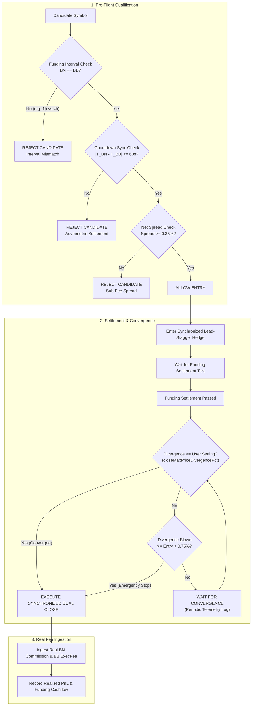

# Implementation Plan: Ultra-Safe Anti-Loss Autonomous Bot Safeguards

This plan outlines the architectural safeguards engineered to eliminate the vulnerability vectors identified in the [Binance ⇄ Bybit Forensic Audit](file:///C:/Users/Administrator/.gemini/antigravity/brain/96e9bf14-d4f9-4915-964a-9c7503f3cf5d/binance_bybit_loss_forensic_report.md), strictly adhering to user instructions to wait for price convergence according to user settings.

---

## User Review Required

> [!IMPORTANT]
> **1. Funding Interval Parity Invariant (Pre-Entry Disqualification):**
> The bot will strictly reject any candidate symbol where Binance and Bybit (or any paired exchanges) have different funding intervals (e.g. `ERAUSDT` 1h vs 4h, or `1000XECUSDT` 4h vs 8h) or when their next funding timestamps differ by more than 60 seconds. This is the root cause that led to one leg paying funding while the other leg had zero settlement.
>
> **2. Price Parity Convergence Honor (User-Specified):**
> As explicitly requested, the bot will **wait until price divergence converges to the exact threshold configured in settings** (`config.closeMaxPriceDivergencePct`, e.g. 0.03% or user-customized value). It will not prematurely force an early exit while price is oscillating normally toward convergence. Capital is safeguarded via the Tier 1 Basis Stop Loss: only if basis blows out dangerously beyond `entryDivergence + 0.75%` is an emergency liquidation triggered.
>
> **3. Minimum Net Spread Filter ($\ge 0.35\%$):**
> Because a 4-leg round-trip taker execution incurs approximately 23 bps (0.23%) in exchange taker fees and Indian GST, candidates with funding spreads below 0.35% will be filtered out to guarantee positive net yield after fees.

---

## Proposed Changes



---

### Component 1: Multi-Exchange Funding Metadata Synchronization

#### [MODIFY] [`exchangeFundingMeta.ts`](file:///C:/AI-Hedge-Cockpit/web/lib/exchangeFundingMeta.ts)
- Extend `SymbolFundingMeta` to include Bybit linear funding intervals (`bybitIntervalHours`) and Bybit next funding timestamps (`bybitNextFundingTime`).
- Query Bybit's public instruments API: `https://api.bybit.com/v5/market/instruments-info?category=linear` alongside Binance and Bitget.
- Enforce interval matching:
  ```typescript
  export function isFundingIntervalSynchronized(
    meta: SymbolFundingMeta,
    venueA: string,
    venueB: string,
    now: number = Date.now()
  ): { synchronized: boolean; reason?: string } {
    const isBnByb = (venueA === "binance" && venueB === "bybit") || (venueA === "bybit" && venueB === "binance");
    if (isBnByb) {
      if (meta.binanceIntervalHours !== meta.bybitIntervalHours) {
        return {
          synchronized: false,
          reason: `Interval mismatch: Binance ${meta.binanceIntervalHours}h vs Bybit ${meta.bybitIntervalHours}h`,
        };
      }
      if (meta.bybitNextFundingTime && meta.binanceNextFundingTime) {
        const deltaMs = Math.abs(meta.binanceNextFundingTime - meta.bybitNextFundingTime);
        if (deltaMs > 60000) {
          return {
            synchronized: false,
            reason: `Settlement time desynchronized by ${Math.round(deltaMs / 1000)}s`,
          };
        }
      }
    }
    return { synchronized: true };
  }
  ```

---

### Component 2: Autonomous Bot Execution Engine & Convergence Exit

#### [MODIFY] [`botEngine.ts`](file:///C:/AI-Hedge-Cockpit/web/lib/botEngine.ts)
1. **Candidate Opportunity Ingestion (Lines 1500–1525):**
   - Replace the blind `Math.min(...candidates)` logic.
   - For any candidate corridor (e.g. Binance ⇄ Bybit), verify that both venues have matching settlement countdowns. If their settlement times differ by $> 60\text{s}$, omit the pair.
   - Verify that the gross directional spread clears round-trip taker fees ($\ge 0.35\%$).
2. **Post-Settlement Convergence Exit (Lines 3577–3626):**
   - Wait until price divergence contracts to $\le \text{config.closeMaxPriceDivergencePct}$ as set in settings.
   - Retain Tier 1 Basis Stop Loss: if divergence expands beyond `entryDivergencePct + 0.75%`, emergency exit.

---

### Component 3: Live Fee & Funding Ledger Ingestion

#### [MODIFY] [`serverTradeStore.ts`](file:///C:/AI-Hedge-Cockpit/web/lib/serverTradeStore.ts)
- Update `recordServerTrade` to accept and prioritize actual fill fee data from execution receipts rather than defaulting to `0.0012`.
- When an execution receipt contains `commission` (Binance) or `execFee` (Bybit), sum them into `trade.feesUsdt`.

#### [MODIFY] [`bybitSigner.ts`](file:///C:/AI-Hedge-Cockpit/web/lib/bybitSigner.ts) & [`binanceSigner.ts`](file:///C:/AI-Hedge-Cockpit/web/lib/binanceSigner.ts)
- Ensure order fill responses extract and return `execFee` and `commission` so the trade store records exact on-chain dollars.

---

### Component 4: Safeguard Regression Test Suite

#### [NEW] [`tests/test_anti_loss_safeguards.js`](file:///C:/AI-Hedge-Cockpit/tests/test_anti_loss_safeguards.js)
- Automated unit test verifying:
  1. `ERAUSDT` is rejected for Binance ⇄ Bybit trading due to 1h vs 4h interval mismatch.
  2. `1000XECUSDT` is rejected when settlement countdowns diverge (4h vs 8h).
  3. Symmetrical 8h pairs (e.g. `BTCUSDT`, `ETHUSDT`) are validated and accepted.
  4. Exit executes when divergence narrows to $\le \text{closeMaxPriceDivergencePct}$.
  5. Minimum net spread filter blocks any candidate with gross spread $< 0.35\%$.

---

## Verification Plan

### Automated Tests
Execute the regression test suite:
```powershell
& "C:\Program Files\nodejs\node.exe" "C:\AI-Hedge-Cockpit\tests\test_anti_loss_safeguards.js"
```
Run the Next.js TypeScript build check:
```powershell
cd "C:\AI-Hedge-Cockpit\web"
& "C:\Program Files\nodejs\npx.cmd" tsc --noEmit
```

### Manual Verification
1. Inspect the Opportunity Scanner on the Cockpit UI: verify `ERAUSDT` is marked `INTERVAL_MISMATCH (1h BN vs 4h BB)` and excluded from automated execution.
2. Verify active bot logs confirm candidate filtration with strict net spread and sync checks.
