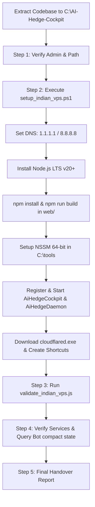

# AI Hedge Cockpit — 24/7 Autonomous Indian VPS Deployment Plan

## Goal Description
Deploy, compile, register, and verify the production-grade **AI Hedge Delta-Neutral Cockpit** on this Indian Windows Server VPS. The deployment transforms the extracted codebase (`C:\AI-Hedge-Cockpit`) into a resilient, 24/7 background operation with zero proxy hops across CoinDCX, Bitget, Bybit, and Binance.

---

## User Review Required

> [!IMPORTANT]
> **Production Real-Money System Invariant**: No paper trading or mocked endpoints are used. All diagnostics and bot heartbeat operations interact with production exchange gateways.
>
> **Execution Mode Decision**: You specified both `/plan` and `/teamwork-preview`. 
> - **Option A (Direct Autonomous Execution - Recommended)**: I execute the elevated PowerShell sequence step-by-step directly in this session, inspecting logs and handling any environment quirks until 100% verification is attained.
> - **Option B (Teamwork Multi-Agent Delegation)**: Delegate to the `teamwork_preview` multi-agent operations team using the drafted prompt.

> [!WARNING]
> **Bybit IP Whitelist**: If your Bybit API Key enforces an IP whitelist, Bybit calls may return error code `10010: "Unmatched IP"`. During Step 3, the script will output the detected Public VPS IP address so you can add it to your Bybit dashboard or switch the key permissions to "No IP restriction".

---

## Open Questions
None. The required sequence, target directory (`C:\AI-Hedge-Cockpit`), credentials, and validation criteria are completely specified.

---

## Proposed Changes & Execution Sequence



### Component 1: Extraction & Environment Verification
* Codebase extracted from `C:\Users\Administrator\Downloads\ai-hedge-cockpit-indian-vps.zip` into `C:\AI-Hedge-Cockpit` (Completed).
* Confirm elevated Administrator token in PowerShell:
  ```powershell
  ([Security.Principal.WindowsPrincipal][Security.Principal.WindowsIdentity]::GetCurrent()).IsInRole([Security.Principal.WindowsBuiltInRole]::Administrator)
  ```

### Component 2: 1-Click VPS Automated Setup (`setup_indian_vps.ps1`)
* **Network DNS**: Set primary DNS to `1.1.1.1` and `8.8.8.8` on active network adapters to eliminate Indian ISP SNI filtering.
* **Node.js LTS**: Verify or install Node.js (v20+) runtime.
* **Web Engine**: Run `npm install --no-audit --no-fund` and `npm run build` inside `C:\AI-Hedge-Cockpit\web`.
* **Process Manager**: Install NSSM at `C:\tools\nssm.exe`.
* **Windows Services Registration**:
  * `AiHedgeCockpit`: Web application running on `http://localhost:3000`.
  * `AiHedgeDaemon`: 24/7 background arbitrage runner executing `scripts\run_daemon_24_7.js`.
* **Remote Access Utility**: Download `cloudflared.exe` into `C:\tools\cloudflared.exe` and generate `start_cloudflare_tunnel.bat` with desktop shortcuts.

### Component 3: Pre-Flight Zero-Proxy Exchange Validation
* Execute:
  ```powershell
  node scripts\validate_indian_vps.js
  ```
* Measure latency and HTTP status across:
  * CoinDCX Futures (`/exchange/v1/derivatives/futures/data/active_instruments`)
  * Bitget Futures (`/api/v2/public/time`)
  * Bybit V5 Linear (`/v5/market/time`)
  * Binance Futures (`/fapi/v1/time`)

### Component 4: Bot Daemon State Verification
* Verify Windows Services:
  ```powershell
  Get-Service -Name AiHedgeCockpit, AiHedgeDaemon
  ```
* Query bot state:
  ```powershell
  node scripts\query_bot_compact.js
  ```
* Confirm: `isRunning: true`, active corridor, and candidate scanning cycle.

---

## Verification Plan

### Automated Tests
1. **Exchange Connectivity Benchmark**:
   ```powershell
   node C:\AI-Hedge-Cockpit\scripts\validate_indian_vps.js
   ```
   *Expected*: All venues return `PASS (200)`, CoinDCX latency < 20ms, zero AWS CloudFront geo-blocking.
2. **Service Process Validation**:
   ```powershell
   Get-Service -Name AiHedgeCockpit, AiHedgeDaemon | Select-Object Name, Status, StartType
   ```
   *Expected*: Both services report Status `Running` and StartType `Automatic`.
3. **Web UI HTTP Response**:
   ```powershell
   Invoke-WebRequest -Uri "http://localhost:3000" -UseBasicParsing | Select-Object StatusCode
   ```
   *Expected*: HTTP 200 / 307 redirect to login.
4. **Live Bot Daemon State Query**:
   ```powershell
   node C:\AI-Hedge-Cockpit\scripts\query_bot_compact.js
   ```
   *Expected*: JSON output displaying `isRunning: true` with active candidate scanning.

### Manual Verification
1. Access web cockpit at `http://localhost:3000` with:
   * **Email**: `varsha633@gmail.com`
   * **Password**: `123456Safe`
2. Test remote connectivity via `start_cloudflare_tunnel.bat` or desktop shortcut.
