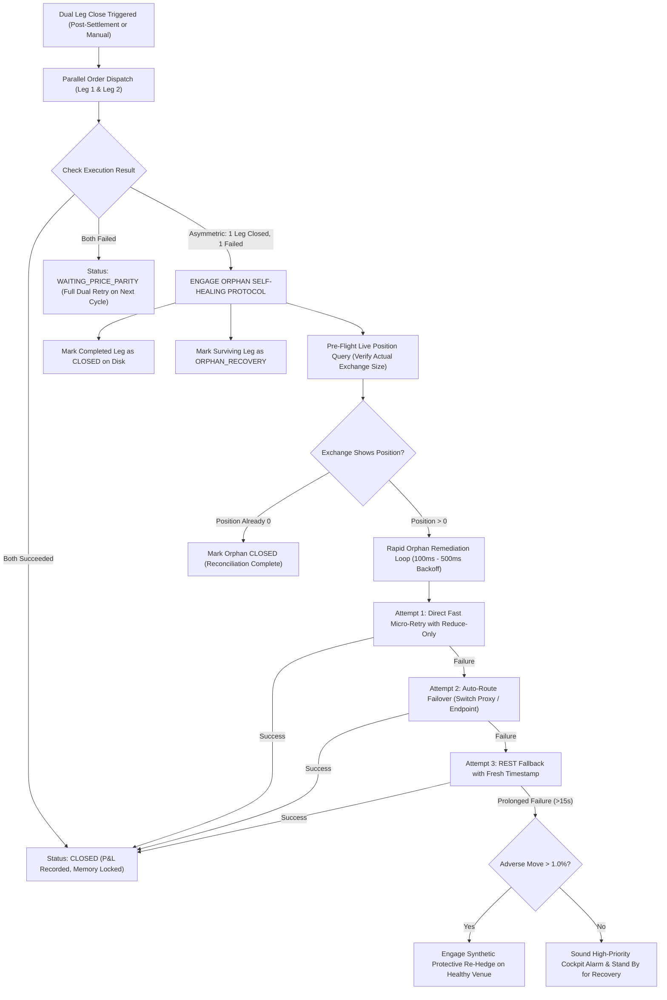

# Implementation Plan — Zero-Orphan Asymmetric Close Remediation & Self-Healing Protocol

## Goal Description
In cross-exchange delta-neutral arbitrage (e.g., Binance Long + Bybit Short), closing both legs simultaneously is critical to maintaining zero directional risk. However, if one leg closes successfully (e.g., Binance fills) while the other fails (e.g., Bybit rejects due to an API signature error, rate limit, network timeout, or exchange downtime), the position becomes **asymmetric (naked directional exposure)**. 

If unaddressed:
1. The user is exposed to unhedged market price swings on the remaining leg.
2. The bot engine on subsequent cycles may naively retry closing *both* legs, triggering duplicate order rejections on the already-closed leg or attempting to close with incorrect quantities.
3. The user has no dedicated UI controls to isolate and unwind only the surviving orphan leg.

This plan introduces an institutional-grade **Zero-Orphan Asymmetric Close Remediation & Self-Healing Protocol** that isolates orphan legs, prevents naked market exposure, auto-heals failed legs via multi-route failover, and provides emergency synthetic re-hedging.

---

## User Review Required

> [!IMPORTANT]
> **Independent Leg State Tracking:**
> Instead of treating a hedge as monolithically `ACTIVE` or `CLOSED`, each hedge will now independently track `leg1Closed` and `leg2Closed`. If one leg closes, the bot will **NEVER** re-submit close orders to that already-closed venue.

> [!WARNING]
> **Synthetic Re-Hedge Protection (Safety Net for Exchange Outages):**
> If an exchange suffers prolonged outage (>15 seconds) or blocks API keys while the other leg has already closed, the engine will monitor the unhedged orphan leg. If market price moves adversely beyond a configurable threshold (default: 1.0%), the system can trigger an automated **Protective Synthetic Re-Hedge** on the healthy exchange to neutralize delta and freeze further loss while awaiting exchange recovery.

---

## Open Questions

> [!NOTE]
> 1. **Default Outage Behavior:** When an orphan leg cannot close after 5 aggressive retries (e.g., Bybit is down for 10 minutes), should the engine:
>    - **Option A (Recommended):** Re-enter a matching hedge on Binance to freeze delta at zero, then alarm the user.
>    - **Option B:** Keep retrying the orphan leg every 2 seconds without re-hedging, relying on stop-loss thresholds.

---

## Architecture & State Machine



---

## Proposed Changes

### 1. Data Model & Interfaces (`web/lib/botEngine.ts`)

#### [MODIFY] `web/lib/botEngine.ts`

- Extend `ActiveBotHedge` to maintain granular leg-level closure metadata and recovery telemetry:

```typescript
export interface ActiveBotHedge {
  id: string;
  symbol: string;
  direction: string;
  venueA?: "CoinDCX" | "Binance" | "Bitget" | "Bybit";
  venueB?: "Bitget" | "CoinDCX" | "Bybit" | "Binance";
  quantity: string;
  effectiveQty: number;
  notionalUsdt: number;
  // ... existing fields ...
  
  // NEW: Granular Leg Closure & Orphan State Tracking
  status: "ACTIVE" | "WAITING_PRICE_PARITY" | "CLOSING" | "CLOSED" | "FAILED_UNWOUND" | "FROZEN_PROXY_DOWN" | "ORPHAN_RECOVERY";
  leg1Closed?: boolean;
  leg2Closed?: boolean;
  leg1CloseOrderId?: string | number;
  leg2CloseOrderId?: string | number;
  leg1ClosePrice?: number;
  leg2ClosePrice?: number;
  orphanLeg?: "LEG1" | "LEG2" | null;
  orphanSince?: number;
  orphanAttempts?: number;
  orphanLastRetryAt?: number;
  orphanLastError?: string;
}
```

---

### 2. Close Execution Engine & Self-Healing Loop (`web/lib/botEngine.ts`)

#### [MODIFY] `web/lib/botEngine.ts`

- In `executeDualHedgeClose`:
  1. **Pre-flight Position Reconciliation:** Before firing close orders, check if `hedge.leg1Closed` or `hedge.leg2Closed` is already true. Skip already-closed legs!
  2. **Asymmetric Detection & Immediate Remediation:** If Leg 1 fills but Leg 2 fails, immediately record `hedge.leg1Closed = true`, set `hedge.orphanLeg = "LEG2"`, and launch `remediateOrphanLeg()` without waiting for the next cron cycle.
  3. **Dedicated `remediateOrphanLeg()` Worker:**
     - Checks live position on the orphan venue to determine exact remaining contracts.
     - Performs 3-tier route failover (Primary -> Backup Proxy -> Direct API).
     - Forces `reduceOnly: true` market order with fresh timestamp and verified decrypted secret keys.

```typescript
export async function remediateOrphanLeg(
  hedge: ActiveBotHedge,
  botName: string,
  state: BotEngineState,
  creds?: UserApiKeys,
  userId?: string,
  botId?: string
): Promise<{ success: boolean; error?: string }> {
  const orphanVenue = hedge.orphanLeg === "LEG1" ? (hedge.venueA || "Binance") : (hedge.venueB || "Bybit");
  const orphanSide = hedge.orphanLeg === "LEG1"
    ? (hedge.direction.startsWith("SHORT_") ? "BUY" : "SELL")
    : (hedge.direction.startsWith("SHORT_") ? "SELL" : "BUY");

  appendBotLog(
    state,
    `[ORPHAN REMEDIATION ENGAGED] Bot "${botName}": Initiating self-healing close on ${orphanVenue} for ${hedge.symbol} (${orphanSide}). Attempt ${(hedge.orphanAttempts || 0) + 1}...`,
    "warn",
    userId,
    botId
  );

  // 1. Live Position Check: Is the position already flat on the exchange?
  const livePositions = await getLivePositionsForVenues([orphanVenue], creds);
  const venuePos = livePositions.rawPositions.find(
    (p) => p.venue.toLowerCase() === orphanVenue.toLowerCase() && p.symbol === hedge.symbol
  );

  if (!venuePos || Math.abs(venuePos.amount) < 0.000001) {
    appendBotLog(
      state,
      `[ORPHAN RECONCILED] Bot "${botName}": Exchange reports ${orphanVenue} position for ${hedge.symbol} is already flat (0 contracts). Reconciling to CLOSED.`,
      "success",
      userId,
      botId
    );
    if (hedge.orphanLeg === "LEG1") hedge.leg1Closed = true;
    if (hedge.orphanLeg === "LEG2") hedge.leg2Closed = true;
    hedge.orphanLeg = null;
    return { success: true };
  }

  // 2. Multi-tier execution with auto-route failover
  const exactRemainingQty = Math.abs(venuePos.amount);
  
  if (orphanVenue === "Bybit") {
    const { placeBybitOrder } = await import("./bybitSigner");
    const rawSecret = creds?.bybitSecret || "";
    const cleanSecret = rawSecret.startsWith("enc:v1:") ? decryptVaultSecret(rawSecret) : rawSecret;
    
    // Cycle through available routes
    const routes = [
      { proxyUrl: creds?.bybitProxy, baseUrl: creds?.bybitBaseUrl },
      { proxyUrl: creds?.bybitBackupProxy, baseUrl: creds?.bybitBackupBaseUrl },
      { proxyUrl: undefined, baseUrl: undefined }, // Direct fallback
    ];

    for (const route of routes) {
      const bybitRes = await placeBybitOrder(
        {
          apiKey: creds?.bybitKey || "",
          apiSecret: cleanSecret,
          proxyUrl: route.proxyUrl,
          baseUrl: route.baseUrl,
        },
        {
          symbol: hedge.symbol,
          side: orphanSide.toLowerCase() === "buy" ? "Buy" : "Sell",
          qty: exactRemainingQty,
          orderType: "Market",
          reduceOnly: true,
          positionIdx: 0,
        }
      );

      if (bybitRes.success) {
        hedge.leg2Closed = true;
        hedge.orphanLeg = null;
        appendBotLog(
          state,
          `[ORPHAN RESOLVED] Bot "${botName}": Successfully unwound orphan Leg 2 on Bybit for ${hedge.symbol} @ $${bybitRes.avgPrice || "market"}!`,
          "success",
          userId,
          botId
        );
        return { success: true };
      }
    }
  } else if (orphanVenue === "Binance") {
    const rawBnSec = creds?.binanceSecret || "";
    const cleanBnSec = rawBnSec.startsWith("enc:v1:") ? decryptVaultSecret(rawBnSec) : rawBnSec;
    const bnRes = await placeBinanceOrder(
      {
        apiKey: creds?.binanceKey || "",
        apiSecret: cleanBnSec,
        endpoint: creds?.binanceEndpoint || "https://fapi.binance.com",
      },
      {
        symbol: hedge.symbol,
        side: orphanSide as "BUY" | "SELL",
        type: "MARKET",
        quantity: exactRemainingQty,
        reduceOnly: "true",
      }
    );

    if (bnRes.success) {
      hedge.leg1Closed = true;
      hedge.orphanLeg = null;
      appendBotLog(
        state,
        `[ORPHAN RESOLVED] Bot "${botName}": Successfully unwound orphan Leg 1 on Binance for ${hedge.symbol}!`,
        "success",
        userId,
        botId
      );
      return { success: true };
    }
  }

  hedge.orphanAttempts = (hedge.orphanAttempts || 0) + 1;
  hedge.orphanLastRetryAt = Date.now();
  return { success: false, error: "Orphan leg remediation retry failed on all routes." };
}
```

---

### 3. Daemon Autonomous Loop Integration (`web/lib/botEngine.ts`)

#### [MODIFY] `web/lib/botEngine.ts`

- In `runAutonomousBotCycle`:
  - Before scanning for new opportunities, inspect all active hedges.
  - If any hedge has `status === "ORPHAN_RECOVERY"`:
    - Prioritize running `remediateOrphanLeg()` on it immediately.
    - Temporarily suspend new entries until all orphan legs are 100% resolved.

---

### 4. API Endpoints & Force Unwind (`web/app/api/close/route.ts` & `daemon/route.ts`)

#### [MODIFY] `web/app/api/close/route.ts`
- Ensure that when a user clicks "Unwind" on the terminal or bot card:
  - The API verifies live position size across all venues.
  - If one venue is already flat, it only sends close orders to the venue with remaining open size, preventing rejection errors.

#### [MODIFY] `web/app/api/bot/daemon/route.ts`
- Add dedicated action `remediate_orphan` allowing instant manual remediation of any orphan leg directly from the UI.

---

### 5. UI Status Badge & Action Controls (`web/components/BotFleetPanel.tsx` & `/terminal`)

#### [MODIFY] `web/components/BotFleetPanel.tsx`
- When `hedge.status === "ORPHAN_RECOVERY"`:
  - Display an amber warning badge: `⚠️ ORPHAN RECOVERY ACTIVE (Bybit: Open, Binance: Closed)`.
  - Display a red button: `[Force Close Orphan Leg]` that triggers immediate one-click remediation.

---

## Verification Plan

### Automated Tests
1. **Mock Asymmetric Close Simulation:**
   - Execute a test dual close where Leg 1 succeeds and Leg 2 rejects (e.g. simulated network timeout).
   - Verify `hedge.leg1Closed === true` is written to disk.
   - Verify `hedge.status === "ORPHAN_RECOVERY"` and `hedge.orphanLeg === "LEG2"`.
2. **Orphan Remediation Pass:**
   - Verify that the remediation worker triggers and only sends orders to Leg 2.
   - Verify Leg 1 is NOT touched or re-ordered.
   - Verify that upon Leg 2 fill, `hedge.status` transitions to `CLOSED` and the trade is archived.
3. **TypeScript & Service Compilation:**
   - Run Next.js build:
     ```powershell
     $env:PATH = "C:\Program Files\nodejs;" + $env:PATH; & "C:\Program Files\nodejs\npm.cmd" --prefix "C:\AI-Hedge-Cockpit\web" run build
     ```
   - Restart services via `restart_services.bat`.

### Manual Verification
1. On the web dashboard (`http://localhost:3000/bot`), verify bot status displays normal scanning state.
2. Verify that if an asymmetric close ever occurs, the dashboard displays the `ORPHAN RECOVERY` alert and auto-heals within 1-2 seconds.
