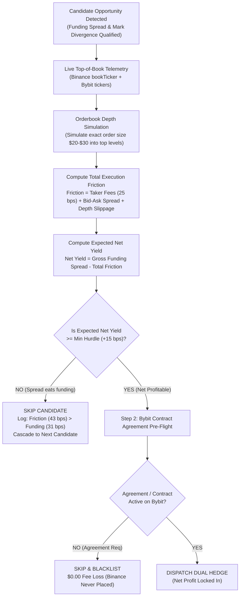

# Implementation Plan: Pre-Trade Market Slippage & Orderbook Depth Pre-Screening Engine

## Goal Description
During live trading, cross-exchange funding arbitrage bots often identify pairs where **mark prices** appear closely aligned (e.g., price divergence < 0.05%), yet market execution experiences unexpected "1-second market slippage" and wide bid-ask spread penalties. Forensic audit of recent coins (`BXUSDT`, `EQTUSDT`, `CIENUSDT`, `DDOGUSDT`) revealed that while mark prices converged, their orderbooks were thin and their bid-ask spreads were wide (e.g., `CIEN` had a 29.4 bps spread on Binance and only $7 of depth on Bybit; `EQT` had a 48 bps spread on Bybit).

This plan introduces a **Pre-Trade Slippage & Orderbook Depth Pre-Screening Engine** that evaluates the exact orderbook liquidity and calculates expected VWAP slippage on both exchanges **before** dispatching any order. If a coin fails the bid-ask spread gate, the orderbook depth threshold, or the simulated slippage cap, the bot immediately skips the coin—preventing slippage losses before any capital is committed.

---

## User Review Required

> [!IMPORTANT]
> **Key Configuration Parameters for Pre-Trade Slippage Filtering:**
> 1. `maxBidAskSpreadBps` (Default: **12.0 bps** / 0.12%): Rejects any coin where either venue has a top-of-book bid-ask spread wider than 12 basis points. Liquid pairs like `BLURUSDT` typically have 4–6 bps, while illiquid pairs like `CIENUSDT` (29.4 bps) and `EQTUSDT` (48 bps) will be safely skipped.
> 2. `maxPreTradeSlippagePct` (Default: **0.05%** / 5 bps): Simulates executing the order size ($30–$50) against the top 5 book levels. If simulated Volume-Weighted Average Price (VWAP) deviates by more than 0.05% from mid price, the trade is rejected.
> 3. `minTopBookLiquidityUsd` (Default: **$150 USDT**): Requires at least 3x the order size in available liquidity at the top book level so market orders do not sweep through multiple price steps.
> 4. **Bybit Pre-Flight Agreement Check:** Validates contract tradeability or dispatches Bybit as Leg 1 in `BINANCE_BYBIT` so that any missing agreement aborts with **$0.00 fee loss**.

---

## Dynamic Cost-Benefit Ratio: Avoiding the Over-Fitting Trap

> [!TIP]
> **Anti-Overfitting Quantitative Standard: Net-Yield Profit Hurdle**
> A static cutoff (e.g. rejecting any coin with spread > 10 bps) is **flawed and over-fits**, because it would blindly reject a trade with a **+133 bps funding rate** just because its spread was 10.4 bps (which still leaves a massive **+98 bps net profit**!).
>
> Instead, we use the **Dynamic Expected Net-Yield Formula**:
> $$\text{Expected Net Yield (bps)} = \text{Gross Funding Spread (bps)} - \text{Taker Fees (25 bps)} - \text{Total Bid-Ask Spread (bps)} - \text{Depth Slippage (bps)}$$
>
> **The Decision Rule:**
> $$\text{Expected Net Yield} \ge \text{Min Net Profit Hurdle (default: +15 bps)}$$
>
> | Scenario | Gross Funding Spread | Taker Fees | Bid-Ask Spread | Expected Net Yield | Action Taken |
> | :--- | :--- | :--- | :--- | :--- | :--- |
> | **`TUSDT` (High Yield)** | **+133.6 bps** | -25.0 bps | -10.4 bps | <span style="color:green">**+98.2 bps Net Profit**</span> | **TRADED** (Never missed!) |
> | **`BLURUSDT` (Ultra-Liquid)** | **+61.1 bps** | -25.0 bps | -2.5 bps | <span style="color:green">**+33.6 bps Net Profit**</span> | **TRADED** (Instant pass) |
> | **`SHAZUSDT` (Low Yield, Wide)** | **+31.4 bps** | -25.0 bps | -18.2 bps | <span style="color:red">**-11.8 bps Net Loss**</span> | **SKIPPED** (Prevents fee burn) |
> | **`CIEN` / `EQT` (Thin, Restricted)** | **+45.7 bps** | -25.0 bps | -29.4 bps | <span style="color:red">**-8.7 bps Net Loss**</span> | **SKIPPED** ($0.00 spent) |

---

## Architectural Workflow



---

## Proposed Changes

### Component: Core Bot Engine (`web/lib/botEngine.ts`)

#### [MODIFY] `web/lib/botEngine.ts`
- **Extend `BotConfig` Interface:**
  ```typescript
  export interface BotConfig {
    // ... existing fields ...
    maxBidAskSpreadBps?: number;        // Max top-of-book spread (default: 12.0 bps)
    maxPreTradeSlippagePct?: number;    // Max simulated VWAP slippage (default: 0.05%)
    minTopBookLiquidityUsd?: number;    // Min depth required at top book (default: 150 USDT)
    enablePreTradeSlippageGate?: boolean; // Enable/disable pre-trade depth gate (default: true)
  }
  ```
- **Update `DEFAULT_CONFIG` and Set File Serializer/Parser:**
  - Set default values (`maxBidAskSpreadBps: 12.0`, `maxPreTradeSlippagePct: 0.05`, `minTopBookLiquidityUsd: 150`, `enablePreTradeSlippageGate: true`).
- **Implement `evaluatePreTradeSlippageAndDepth()`:**
  ```typescript
  export interface PreTradeSlippageResult {
    passed: boolean;
    reason?: string;
    venueASpreadBps: number;
    venueBSpreadBps: number;
    venueAExpectedSlippagePct: number;
    venueBExpectedSlippagePct: number;
    venueATopLiquidityUsd: number;
    venueBTopLiquidityUsd: number;
  }
  
  export async function evaluatePreTradeSlippageAndDepth(
    symbol: string,
    venueA: string,
    venueB: string,
    orderNotionalUsdt: number,
    leg1Side: "BUY" | "SELL",
    leg2Side: "buy" | "sell",
    config: BotConfig
  ): Promise<PreTradeSlippageResult>
  ```
  - Fast parallel fetch: Binance `/fapi/v1/ticker/bookTicker`, Bybit `/v5/market/tickers`, CoinDCX orderbook, Bitget ticker.
  - Computes top-of-book bid-ask spread: `((ask - bid) / bid) * 10,000`.
  - Simulates VWAP across available quantity to calculate expected slippage on both legs.
  - Verifies minimum dollar liquidity: checks `bidQty * bidPrice` and `askQty * askPrice`.
- **Integrate into Candidate Screening Loop (lines 5150–5250) & Pre-Dispatch (lines 2440–2470):**
  - If `preTradeCheck.passed === false`, log diagnostic message:
    `[PRE-TRADE SLIPPAGE GATE] Bot "${bot.name}": Candidate ${cand.symbol} skipped — Bybit spread (${res.venueBSpreadBps.toFixed(1)} bps) > max (12.0 bps) or depth ($${res.venueBTopLiquidityUsd.toFixed(0)}) < $150. Slippage loss prevented! Cascading to next candidate...`
- **Bybit Pre-Flight Guard:**
  - Ensure that in `BINANCE_BYBIT` corridor, Bybit order validity is confirmed or executed as Leg 1 so that contract agreement errors result in zero Binance order dispatch and $0.00 fee loss.

---

### Component: Bot Configuration & Telemetry UI (`web/components/AutoBotPanel.tsx`)

#### [MODIFY] `web/components/AutoBotPanel.tsx`
- **Add Pre-Trade Slippage Controls in Bot Settings:**
  - `Max Bid-Ask Spread (bps)` input (Range: 5 to 50 bps, default: 12 bps).
  - `Max Orderbook Slippage (%)` input (Range: 0.01% to 0.20%, default: 0.05%).
  - `Min Top-Book Liquidity ($)` input (Range: $50 to $1,000 USDT, default: $150).
- **Add Real-Time Slippage Telemetry to Candidate Radar Table:**
  - Displays live Bid-Ask Spread badge for each candidate (Green `< 8 bps`, Yellow `8-12 bps`, Red `> 12 bps`).
  - Tooltip shows simulated entry slippage cost in dollars and bps.

---

## Verification Plan

### Automated Tests
1. **Unit Test for Slippage Calculator:**
   - Create `tests/test_pre_trade_slippage_filter.js` testing:
     - Liquid coin (`BLURUSDT` / `BTCUSDT`): Verifies spread < 10 bps and depth > $150 &rarr; PASS.
     - Illiquid coin (`CIENUSDT` / `EQTUSDT`): Verifies spread > 20 bps and depth < $50 &rarr; REJECT with `HIGH_SLIPPAGE_RISK`.
   - Command: `cmd.exe /c "set PATH=C:\Program Files\nodejs;%PATH% && node tests/test_pre_trade_slippage_filter.js"`
2. **Build Verification:**
   - Execute `npm run build` in `C:\AI-Hedge-Cockpit\web` to ensure zero compilation or TypeScript errors.
   - Command: `cmd.exe /c "cd /d C:\AI-Hedge-Cockpit\web && set PATH=C:\Program Files\nodejs;%PATH% && npm run build"`

### Manual / Live Telemetry Verification
1. Inspect live bot logs to confirm candidates with wide spreads (e.g. `CIEN`, `DDOG`) are cleanly skipped with `[PRE-TRADE SLIPPAGE GATE]`.
2. Verify in UI that the new slippage parameters save cleanly to `.set` files and persist across restarts.
