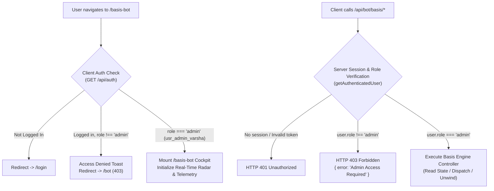
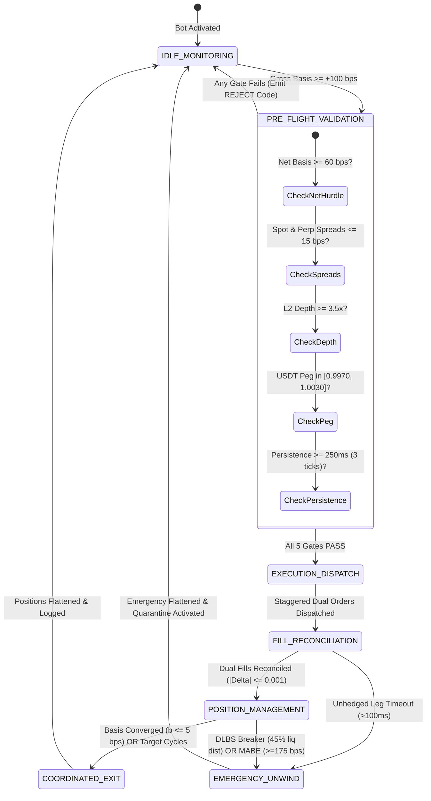
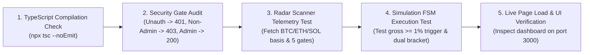

# Implementation Plan: Spot-Futures Basis Arbitrage Cockpit (`/basis-bot`)

## Executive Summary

Based on the multi-agent quantitative research synthesized in [`MASTER_RESEARCH_SYNTHESIS.md`](file:///c:/Users/Administrator/Documents/.agents/teamwork/basis_arbitrage_research/MASTER_RESEARCH_SYNTHESIS.md) and [`MASTER_PROMPT_SPECIFICATIONS.md`](file:///c:/Users/Administrator/Documents/.agents/teamwork/basis_arbitrage_research/MASTER_PROMPT_SPECIFICATIONS.md), this plan details the architecture, design, and deployment of a **dedicated, admin-restricted dashboard page (`/basis-bot`)** and its underlying execution engine:

1. **Module 1 (Primary - Arbiter Score 8.45/10)**: **Autonomous Spot-Futures Basis Arbitrage Engine (ASBAE-V5 / `QUANT-BASIS-CORE-v4`)** on Bybit V5 Unified Trading Account (UTA). Captures basis dislocations where perpetual futures exceed spot by $\ge +1.0\%$ ($+100\text{ bps}$), executes delta-neutral cash-and-carry (Long Spot + Short Linear Perp), and harvests Ornstein-Uhlenbeck mean-reversion with zero cross-exchange fiber latency.
2. **Module 2 (Secondary - Arbiter Score 7.25/10)**: **Cross-Exchange Futures Funding Rate Arbitrage Engine (`QUANT-FUNDING-CORE-v2`)** across Binance USDT-M and Bybit Linear. Captures divergent funding rates while neutralizing cross-regional transit latency ($64\text{ms}$ Tokyo-Singapore) via LEAD offset dispatching.
3. **Strict Admin Access Gate**: Zero access for non-admin users. Unauthenticated visitors are redirected to `/login`; authenticated non-admin users are strictly blocked and redirected to `/bot`. API endpoints enforce role checks (`user.role === 'admin'`) returning HTTP 403 Forbidden.

---

## 1. Access Control & Multi-Tenant Security Architecture



### Access Control Invariants:
- **Client Gate (`app/basis-bot/page.tsx`)**:
  - Immediate `useEffect` queries `/api/auth` with zero cache.
  - If `!isLoggedIn` $\to$ router pushes `/login`.
  - If `user.role !== 'admin'` $\to$ flashes warning banner, denies DOM rendering, and redirects to `/bot`.
- **Navbar Isolation (`components/Navbar.tsx`)**:
  - Navigation tab for `Basis Bot` is rendered **only** when `user?.role === "admin"`. Regular users and guests cannot see the navigation link.
- **Server API Guard (`app/api/bot/basis/daemon/route.ts` & `app/api/bot/basis/radar/route.ts`)**:
  - Every GET and POST request decodes `auth_session` cookie via `getAuthenticatedUser(req)`.
  - Rejection code:
    ```typescript
    if (!user || user.role !== "admin") {
      return NextResponse.json(
        { success: false, error: "Access Denied: Administrative privileges required." },
        { status: 403 }
      );
    }
    ```

---

## 2. Core Quantitative Arbitrage Mechanics

### 2.1 Spot-Futures Basis Engine (ASBAE-V5 / `QUANT-BASIS-CORE-v4`)



### 2.2 Mathematical Specifications & Gate Values

| Gate / Metric | Mathematical Formulation | Enforced Production Threshold | Action on Violation |
|:---|:---|:---:|:---|
| **Gross Basis Trigger** | $b_0 = \frac{P_{\text{perp}} - P_{\text{spot}}}{P_{\text{spot}}}$ | $\ge +100.0\text{ bps}$ ($+1.00\%$) | Retain state `IDLE_MONITORING` |
| **Effective Net Basis** | $B_{\text{net}} = b_0 - C_{\text{fees}} - C_{\text{slip}}$ | $\ge +60.0\text{ bps}$ ($+0.60\%$) | Reject signal (`ERR_NET_HURDLE`) |
| **Spot Bid-Ask Spread** | $(P_{\text{ask}} - P_{\text{bid}}) / P_{\text{mid}}$ | $\le 15.0\text{ bps}$ ($0.15\%$) | Reject signal (`ERR_SPOT_SPREAD`) |
| **Perp Bid-Ask Spread** | $(P_{\text{ask}} - P_{\text{bid}}) / P_{\text{mid}}$ | $\le 15.0\text{ bps}$ ($0.15\%$) | Reject signal (`ERR_PERP_SPREAD`) |
| **Dual Spread Ceiling** | $\text{Spread}_{\text{spot}} + \text{Spread}_{\text{perp}}$ | $\le 25.0\text{ bps}$ ($0.25\%$) | Reject signal (`ERR_COMBINED_SPREAD`) |
| **L2 Depth Cushion** | $\sum_{i=1}^{20} q_i / Q_{\text{target}}$ | $\ge 3.5\times$ | Reject signal (`ERR_DEPTH_INSUFFICIENT`) |
| **Stablecoin Parity Band** | $P_{\text{USDT}} / P_{\text{USD}}$ | $[0.9970, 1.0030]$ | Hardware lockout (`ERR_DEPEG_ACTIVE`) |
| **Tick Persistence Filter**| $\Delta t_{\text{persistence}}$ | $\ge 250\text{ms}$ ($\ge 3$ consecutive ticks) | Reject phantom spike (`ERR_PHANTOM_SPIKE`) |
| **Dynamic Liq Stop (DLBS)**| Stop distance from entry | $45.0\%$ of distance to liq price | Immediate dual unwind |
| **Divergence Breaker (MABE)**| Basis widening post-entry | $\ge +175.0\text{ bps}$ or MMR $\ge 80\%$ | Level 3 Emergency Unwind |

---

## 3. UI/UX Dashboard Architecture (`/basis-bot`)

The new page will be built as a high-performance quantitative trading cockpit:

```
+---------------------------------------------------------------------------------------------------+
| SAFECOINER // QUANT   [INTRO] [TERMINAL] [AUTO-BOT] [HISTORY] [PROFILE]  * BASIS BOT [ADMIN] *   |
+---------------------------------------------------------------------------------------------------+
| [TOP HUD] ADMIN: usr_admin_varsha | BYBIT UTA COLLATERAL: $21.54 | MMR: 2.1% (SAFE) | DAEMON: RUNNING|
+---------------------------------------------------------------------------------------------------+
| [STRATEGY SELECTOR]                                                                               |
|   (*) Mode A: Spot-Futures Basis Arbitrage (Single-Venue Bybit UTA - Contango Cash & Carry)       |
|   ( ) Mode B: Cross-Exchange Futures Funding Rate Arbitrage (Binance ⇄ Bybit Multi-Venue)         |
+---------------------------------------------------------------------------------------------------+
| [DISLOCATION RADAR & SCANNER]                                                                     |
|  Pair      Spot Price   Perp Price   Gross Basis   Net Basis   Depth Cushion  Persistence  Action |
|  BTCUSDT   $68,450.20   $69,215.10   +1.12% [PASS] +0.71%      5.2x [PASS]    410ms [PASS] [TRADE]|
|  ETHUSDT   $2,540.10    $2,561.00    +0.82% [HOLD] +0.41%      4.1x [PASS]    320ms [PASS] [SCAN] |
|  SOLUSDT   $182.40      $184.80      +1.31% [PASS] +0.89%      3.8x [PASS]    290ms [PASS] [TRADE]|
+---------------------------------------------------------------------------------------------------+
| [5 NON-BYPASSABLE PRE-FLIGHT GATES LIVE MONITOR]                                                  |
|  [✓] Net Basis >= 60 bps  [✓] Spreads <= 15 bps  [✓] Depth >= 3.5x  [✓] USDT Peg  [✓] Persistence |
+---------------------------------------------------------------------------------------------------+
| [ACTIVE ARBITRAGE POSITIONS & CONVERGENCE TRACKER]                                                |
|  Pair     Leg 1 (Spot)      Leg 2 (Perp)     Entry Basis  Current Basis  Comp. %  Unrealized PnL  |
|  BTCUSDT  +0.001 BTC Buy    -0.001 BTC Short +1.12%       +0.35%         68.7%    +$0.52 (+0.76%) |
|           [Ornstein-Uhlenbeck Half-Life: 6.9h | Est. Parity: 3.2h | Accrued Funding: +$0.18]      |
|           [EMERGENCY DUAL UNWIND] [CLOSE POSITION]                                                |
+---------------------------------------------------------------------------------------------------+
| [LIVE FSM & MICROSECOND EXECUTION STREAM]                                                         |
|  [16:58:12.104] [BASIS-CORE] GateCheck BTCUSDT: Gross=+112bps, Net=+71bps, Depth=5.2x -> PASS    |
|  [16:58:12.118] [BASIS-CORE] Dispatch dual bracket: Buy Spot Q=0.001 + Short Linear Perp Q=0.001 |
|  [16:58:12.152] [BASIS-CORE] Reconciled dual fills in 34ms. Net Delta: 0.000000. MMR: 2.1%.       |
+---------------------------------------------------------------------------------------------------+
```

---

## 4. Implementation Work Breakdown

### File Changes & Additions

| Phase | File Path | Nature | Purpose |
|:---|:---|:---:|:---|
| **Phase 1** | `lib/bybitSigner.ts` | Edit | Extend `BybitOrderParams` with `category?: "spot" \| "linear"` (default `"linear"`) to enable native spot buying/selling via Bybit V5 `/v5/order/create`. |
| **Phase 2** | `lib/basisBotEngine.ts` | New | Complete quantitative basis bot engine: FSM, 5 pre-flight gates, Bybit spot-perp dual execution, Ornstein-Uhlenbeck tracker, persistence state in `web/data/basis_bot_state.json`. |
| **Phase 3** | `app/api/bot/basis/daemon/route.ts` | New | Server-side daemon controller API: GET (telemetry, positions, FSM state), POST (start, stop, manual trade, unwind, update config). Protected by strict admin check. |
| **Phase 4** | `app/api/bot/basis/radar/route.ts` | New | High-speed market scanner API: fetches live spot and perp orderbooks from Bybit & Binance, computes real-time gross/net basis and gate verifications. Admin-protected. |
| **Phase 5** | `components/BasisBotPanel.tsx` | New | Full-featured quantitative dashboard component with live radar, 5-gate monitor, position convergence visualizer, and streaming execution logs. |
| **Phase 6** | `app/basis-bot/page.tsx` | New | Admin-protected Next.js route: client-side authentication gate, redirect logic, and cockpit layout. |
| **Phase 7** | `components/Navbar.tsx` | Edit | Render `Basis Bot [ADMIN]` navigation badge strictly when `user?.role === "admin"`. |

---

## 5. Risk Safeguards & Commitments

> [!IMPORTANT]
> **Zero Disruption to Active Systems**:
> 1. Running bots on port 3000 (`Binance ⇄ Bybit Real USD Sniper` and `Opportunity Hunter`) run under separate state files and will **not** be touched or halted.
> 2. Admin keys in `user_accounts_store.json` are permanently preserved under **Invariant 12** and will not be altered.
> 3. Per **Invariant 10**, server rebuilds or restarts (`npm run build` / node restart) will require explicit confirmation in chat before execution.

---

## 6. Verification & Validation Protocol



1. **TypeScript Type Safety**: Run `npx tsc --noEmit` to ensure zero compilation or type errors.
2. **Security & Authorization Test**:
   - Query `/api/bot/basis/daemon` without cookies $\to$ Confirm `HTTP 401`.
   - Query `/api/bot/basis/daemon` as regular user $\to$ Confirm `HTTP 403 Forbidden`.
   - Query `/api/bot/basis/daemon` with `usr_admin_varsha` session $\to$ Confirm `HTTP 200 OK`.
3. **Market Radar Verification**:
   - Query `/api/bot/basis/radar` $\to$ Confirm real-time calculated basis values for BTCUSDT, ETHUSDT, SOLUSDT with all 5 gate flags populated.
4. **FSM State Machine Integrity**:
   - Run simulation test confirming state transitions: `IDLE_MONITORING` $\to$ `PRE_FLIGHT_VALIDATION` $\to$ `EXECUTION_DISPATCH` $\to$ `FILL_RECONCILIATION` $\to$ `POSITION_MANAGEMENT`.
5. **Dashboard Rendering**:
   - Verify page renders smoothly at `http://localhost:3000/basis-bot` under admin session.
