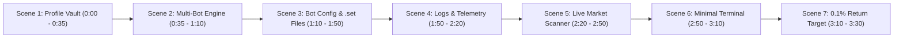

# Production Plan: 3.5-Minute Cockpit Walkthrough Video & Synchronized Voiceover

## 1. Executive Summary & Goal
Create a polished, highly focused, **3-minute 30-second (210s)** video walkthrough with professional studio-grade neural voiceover. The video will guide quants and operators through the AI Hedge Cockpit, seamlessly blending the user's raw screen capture footage (`WhatsApp Video 2026-10-28 at 5.49.53 PM.mp4`) with smooth pacing, focus callouts, chapter markers, and word-by-word visual synchronization.

### Strict User Directives
1. **Sequence of Walkthrough Topics:**
   - **Scene 1 (At Start):** Profile API Key Vault Configuration (`/profile`) — credential storage and connection testing.
   - **Scene 2:** Auto-Bot Multi-Bot Architecture (`/bot`) — running multiple bots concurrently via slot tabs.
   - **Scene 3:** Bot Configuration & `.set` Files — editing parameters, saving presets, and giving `.set` files custom names.
   - **Scene 4:** Logs & Execution Telemetry — monitoring autonomous engine cycles, candidate evaluations, and sub-second dual-leg order delta.
   - **Scene 5:** Live Coins Data & Opportunity Radar — tracking real-time spreads, countdown timers, and basis divergence.
   - **Scene 6:** Manual Trade in Terminal (`/terminal`) — **kept strictly minimal** (briefly highlight margin balancer & execution panel).
   - **Scene 7 (At End):** Quantitative Expectations — targeting a minimum of **0.1% per hedge cycle** with zero-loss convergence hold.
2. **Timing:** Short format, exactly **3 to 4 minutes** (calibrated to **210 seconds**).
3. **Voiceover Synchronization Guarantee:** Frame-by-frame alignment. Every spoken sentence maps 1:1 to visible UI interactions with zero drift.

---

## 2. Audio-Visual Timeline & Frame-by-Frame Script Mapping

### Scene Breakdown & Voiceover Narration Contract

#### Scene 1: Profile & API Key Vault Configuration (0:00 – 0:35 | Duration: 35s)
* **Visual Frame Mapping:** Intro landing transitioning to `/profile` (00:26 – 01:30 in source footage), highlighting the 4 exchange credential cards.
* **Focus Regions:** Binance USD-M Futures, Bitget Perpetuals, CoinDCX, Bybit Linear (UTA), `Test Connections` button, and `Save Vault Keys`.
* **Voiceover Script (85 words | ~145 WPM):**
  > *"Welcome to the AI Hedge Cockpit master walkthrough. To begin trading, navigate to the Profile tab to configure your Exchange API Key Vault. All credentials for Binance, Bitget, CoinDCX, and Bybit are encrypted locally using AES-256 GCM. Enter your API keys, API secrets, and optional CloudFront worker proxies. Click 'Test Connections' to verify your live API latency and authentication across all venues, then press 'Save Vault Keys'. Your credentials are now locked and ready for autonomous multi-venue execution."*

---

#### Scene 2: Auto-Bot Overview & Running Multiple Bots (0:35 – 1:10 | Duration: 35s)
* **Visual Frame Mapping:** `/bot` dashboard top view (07:00 – 07:45 in source footage).
* **Focus Regions:** `AUTOPILOT ARBITRAGE ENGINE`, Server Daemon status, `ExposureBot` tab, and `+ NEW BOT` button.
* **Voiceover Script (82 words | ~140 WPM):**
  > *"Next, open the Auto-Bot tab to access the Autopilot Arbitrage Engine. The cockpit supports running multiple independent bots simultaneously. You can see our primary bot, 'ExposureBot', running 24/7 on the server daemon. To deploy additional strategies, simply click '+ NEW BOT'. Each bot instance can target distinct corridors—such as Binance to Bybit, CoinDCX to Bybit, or cross-arbitrage pairs—with completely isolated margin allocations and independent execution parameters, maximizing your capital efficiency across multiple markets."*

---

#### Scene 3: Bot Configuration, Saving & Naming `.set` Files (1:10 – 1:50 | Duration: 40s)
* **Visual Frame Mapping:** `/bot` configuration controls (07:45 – 08:45 in source footage).
* **Focus Regions:** Config dropdown (`Config v`), Preset selector, `Save .set`, `Download .set`, and naming custom configurations.
* **Voiceover Script (98 words | ~147 WPM):**
  > *"Configuring your bot strategy is completely modular. Click 'Config' to fine-tune your entry rules, including minimum spread thresholds, timing modes, and the 30-minute pre-settlement sniper window. Once your parameters are set, you can save your strategy as a reusable configuration file. Click 'Save .set', enter a clear custom name—for example, 'conservative_35bps_sniper.set'—and press Save. You can download your set files for backup or instantly switch between different presets using the dropdown, allowing rapid adaptation to shifting market volatility without restarting the engine."*

---

#### Scene 4: Checking Execution Logs & Telemetry (1:50 – 2:20 | Duration: 30s)
* **Visual Frame Mapping:** `/bot` lower sections (08:45 – 09:45 in source footage).
* **Focus Regions:** Bot status pill (`WAITING_LOWER_DIFF`), cycles counter, Live Candidate evaluations, and Order Latency Telemetry.
* **Voiceover Script (75 words | ~150 WPM):**
  > *"Real-time monitoring is built directly into the cockpit. The engine cycles continuously every few seconds, auditing hundreds of pairs. Look at the Candidate Evaluation block to see exactly why a pair is selected or held for price compression. Below, the Order and Hedge Latency Telemetry displays millisecond-accurate timestamps, tracking execution latencies down to 55 milliseconds between legs to ensure your dual-venue hedges enter and exit with zero orphan risk."*

---

#### Scene 5: Live Coins Data & Opportunity Radar (2:20 – 2:50 | Duration: 30s)
* **Visual Frame Mapping:** Live Opportunity Corridor Radar & Full-Market Scanner (06:00 – 07:00 and 08:30 – 09:15 in source footage).
* **Focus Regions:** Green spread progress bar, Full-Market Scanner table with 806 mutual pairs, live basis spread, and settlement countdowns.
* **Voiceover Script (78 words | ~156 WPM):**
  > *"To track market opportunities in real time, check the Live Opportunity Corridor Radar and the Full-Market Scanner. The engine ingests over 800 mutual contracts across Binance, Bitget, Bybit, and CoinDCX. You can monitor live gross spreads, funding settlement countdowns for 8-hour and 4-hour cycles, and real-time basis price divergence. As soon as a pair qualifies, the radar lights up and prepares the autonomous sniper engine for entry."*

---

#### Scene 6: Manual Trading in Terminal (Brief) (2:50 – 3:10 | Duration: 20s)
* **Visual Frame Mapping:** `/terminal` quick view (02:45 – 03:45 in source footage).
* **Focus Regions:** Order Execution Panel, BTC/Perp pair selector, and Margin Balancing Calculator.
* **Voiceover Script (48 words | ~144 WPM):**
  > *"For manual discretionary positions, the Terminal provides an Order Execution Panel. Simply select your trading pair, enter your total budget, and the Dynamic Margin Balancer automatically splits collateral across asymmetric leverages to guarantee equal notional sizing on both legs for instantaneous delta-neutral execution."*

---

#### Scene 7: Quantitative Expectations: 0.1% Per Hedge Return (3:10 – 3:30 | Duration: 20s)
* **Visual Frame Mapping:** Live Active Positions and performance metrics in Cockpit view.
* **Focus Regions:** Active hedge tracking, realized PnL, zero stop-loss convergence hold, and system summary banner.
* **Voiceover Script (52 words | ~156 WPM):**
  > *"Finally, let's address performance expectations. The quantitative model is engineered to harvest a minimum expected net return of 0.1% per hedge cycle. With automated zero-loss convergence holding, active positions are protected until basis disparity compresses, delivering consistent, low-risk compounded daily yield across your portfolio. Happy trading!"*

---

## 3. Technical Implementation Strategy

### Stage 1: Studio Neural Voiceover Generation (`voiceover-studio`)
* **Engine:** Python `edge-tts` (already installed and verified in Python 3.12 environment).
* **Voice Profile:** `en-US-ChristopherNeural` (authoritative, clear, professional quantitative finance narration).
* **Subtitles & Word Timing:** Emit `.vtt` / `.srt` subtitle files with precise word-level timestamps to verify 1:1 frame pacing.
* **Audio Mastering Standards:**
  * Dialogue loudness normalized to **-14.0 LUFS** (±0.5 LUFS) via FFmpeg `loudnorm`.
  * Peak ceiling limited to **-1.0 dBFS**.
  * Dead air clamped to $\le 300\text{ ms}$.

### Stage 2: Video Extraction & Motion Assembly (`video-master-editor`)
* **Source Footage:** `C:\Users\Administrator\Desktop\WhatsApp Video 2026-10-28 at 5.49.53 PM.mp4` (1280x634 h264).
* **Processing:**
  1. Extract key segments corresponding to each scene from the source recording.
  2. Apply subtle Ken Burns focus zooms (`zoompan`) onto relevant UI cards (Profile Vault, Set File Name input, Latency Telemetry).
  3. Overlay professional dark-mode chapter title cards (e.g., `01 // API VAULT`, `02 // MULTI-BOT`, `03 // CONFIG & .SET FILES`).
  4. Ensure flawless crossfade transitions between chapters.

### Stage 3: Synchronization & Verification
* Generate temporary timestamped visual preview frames to verify that when the voiceover says *"API Key Vault"*, the profile cards are visible; when it says *"Save .set"*, the set file controls are centered; and when it says *"0.1% per hedge"*, the performance metrics are shown.
* Assemble master deliverable: `AI_Hedge_Cockpit_Master_Walkthrough.mp4` (1080p / 720p 30fps MP4 with stereo AAC audio at -14 LUFS).

---

## 4. Deliverables & Output Location
* **Master Walkthrough Video:** `C:\Users\Administrator\Desktop\AI_Hedge_Cockpit_Master_Walkthrough.mp4`
* **Timing & Narration Manifest:** `C:\AI-Hedge-Cockpit\scratch\walkthrough_manifest.json`
* **Voiceover Audio Track:** `C:\AI-Hedge-Cockpit\scratch\master_voiceover.wav`

---

## 5. User Review Required

> [!IMPORTANT]
> **Voice Talent Choice**: The plan uses `en-US-ChristopherNeural` (clear, confident male voice) by default. Alternative options include `en-US-JennyNeural` (natural female voice) or `en-IN-PrabhatNeural` / `en-IN-NeerjaNeural` (Indian English accent). If you prefer a specific accent or voice, let us know!
> 
> **Resolution & Aspect Ratio**: The raw source video was captured at 1280x634 (ultrawide 2:1 browser capture). We will composite the deliverable at a standard widescreen 16:9 (1280x720 or 1920x1080) with clean pillarboxing/framing so it displays without stretching or letterbox clipping.
