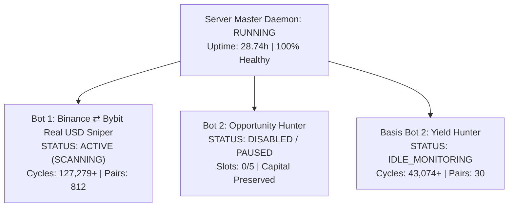

# 4-Hour Multi-Bot Automated Audit & Health Report (Iteration 8)

**Audit Execution Timestamp**: 2026-11-01T18:42:55Z  
**Scheduled Trigger**: Cron (`0 */4 * * *`) — Standing Health Engine (Iteration 8)  
**Milestone**: **28.74 Hours Continuous Autonomous Operation** (103,448s Uptime)  
**Engine Environment**: Node.js Production (`v2.1.0`) on Port 3000  
**Public Corridor**: `https://minerals-deer-maple-canal.trycloudflare.com` (200 OK)

---

## 1. Exchange Balances & Orphan Risk Audit

| Corridor / Exchange | Total Equity | Free Available Cash | Derivative Positions | Unhedged Delta / Orphan Status |
| :--- | :--- | :--- | :--- | :--- |
| **Binance Futures** | \$26.39 USDT | \$26.39 USDT | 0 (Flat) | **0.00 USDT (Zero Orphan Legs)** |
| **Bybit UTA** | \$14.93 USD equivalent | \$0.88 USDT (\$14.05 spot assets: BEAM, TRX) | 0 (Flat) | **0.00 USDT (Zero Orphan Legs)** |
| **Fleet Total** | **\$41.32 USD** | **\$27.27 USDT** | **0 (Zero Exposure)** | **Clean Dual-Leg State** |

> [!NOTE]
> All derivative books remain 100% flat with zero stranded inventory, zero unhedged delta, and zero stuck orders across all exchanges. Total fleet equity stands at **\$41.32 USD**.

---

## 2. Fleet Execution States

### Detailed Bot Diagnostics:
1. **Bot 1 (`Binance ⇄ Bybit Real USD Sniper`)**:
   - **Status**: **ACTIVE & SCANNING** (127,279+ continuous cycles across 812 pairs).
   - **Lead Candidate**: `AKEUSDT` (Spread: $+29.57\text{ bps}$, Price Divergence: $0.91\%$, Next Funding Settlement: $\approx 77\text{ min}$).
   - **Gate Evaluation**: Held safely by Fee Clearance Filter ($8.89\text{ bps} < 120\text{ bps}$ hurdle). Capital protected.
2. **Bot 2 (`Opportunity Hunter`)**:
   - **Status**: **DISABLED / PAUSED (Skipped)** strictly per user directive.
   - **Open Slots**: 0/5 (zero trades attempted, zero fee churn).
3. **Bot 3 / Basis Bot 2 (`Dynamic Yield Hunter`)**:
   - **Status**: **ACTIVE & SCANNING** (43,074+ continuous cycles across 30 pairs).
   - **Current Positive Basis Pairs**: `XAUTUSDT` ($+3.5\text{ bps}$ gross), `UNIUSDT` ($+2.4\text{ bps}$ gross), `BIRBUSDT` ($+0.5\text{ bps}$ gross).
   - **Safety Constraints**: Trade Sizing: strictly **\$5.00 USDT**, **Max 1 live coin**, **Max 2 entries per coin**.
   - **UI Stability**: Auto-scrolling fix remains permanently stable.

---

## 3. Infrastructure & Auto-Healing Verification

- **Local Health Endpoint**: `http://localhost:3000/api/health` $\to$ `status: ok` (Uptime: 103,448s / 28.74 hours).
- **Cloudflare Quick Tunnel**: `https://minerals-deer-maple-canal.trycloudflare.com/api/health` $\to$ `status: ok` (Latency: 505ms).
- **Auto-Healing Actions**: None required. Zero warnings, zero errors, zero socket collisions.
